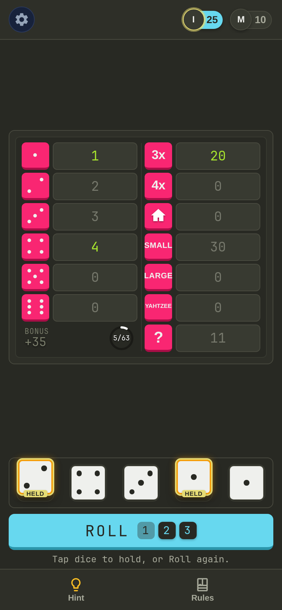

# Yahtzee

Yahtzee for phones and desktops. Play hot-seat on one device with 1 to 4 players, or online in a room with a four-letter code. No accounts, no database, no dependencies.

Live at https://yahtzee.ianmcmanus.net



## Features

- Standard Yahtzee scoring, including the 35 point upper bonus and 100 point extra Yahtzees.
- Hot-seat play for 1 to 4 players. A game in progress is saved in the browser and can be resumed.
- Online rooms for 2 to 4 players. Share the code or an invite link; the server enforces turns and everyone sees the board update live.
- Tap a player's badge to look at their scorecard. A Hint button highlights the best open category.
- Installable as a PWA on Android and iOS. After the first visit, hot-seat play works with no network.
- Monokai theme with JetBrains Mono, matching the author's other homelab apps.

## Run it

Node 22 or newer. There are no packages to install.

```bash
npm start
```

This serves the site and the room API on http://localhost:8080. Set `PORT` to change the port.

With Docker:

```bash
docker build -t yahtzee .
docker run -p 8080:8080 yahtzee
```

The image runs as a non-root user and has a health check on `/healthz`.

A plain static file server also works. Hot-seat play needs nothing else; the online button then reports an error.

## Tests

```bash
npm test
```

Uses the built-in `node:test` runner. The tests cover scoring, game state, the room store, the HTTP server, the UI model and the PWA files.

## How it works

| Path | What it does |
| --- | --- |
| `site/score.js` | Scoring rules. Runs in the browser and in Node. |
| `site/game.js` | Game state: rolls, holds, turns, winner. Pure functions. |
| `site/ui-model.js` | Tile layout, pip positions and bonus progress for the UI. |
| `site/app.js`, `site/online.js` | Rendering, hot-seat mode and the online client. |
| `site/sw.js`, `site/pwa.js`, `site/manifest.webmanifest` | PWA service worker, its registration, and the manifest. |
| `server/rooms.js` | In-memory room store. Runs `game.js` as the referee. |
| `server/server.js` | HTTP server: static files, room API, Server-Sent Events. |

The server owns the game in online play. Clients send actions (`roll`, `hold`, `score`) and receive the full state over an event stream. Each player has a random token, and tokens never appear in any state the server sends. Rooms live in memory, expire after two hours of inactivity, and are lost on restart.

API:

| Route | Purpose |
| --- | --- |
| `POST /api/rooms` | Create a room. Returns `{ code, token }`. |
| `POST /api/rooms/:code/join` | Join a room. Returns `{ token }`. |
| `POST /api/rooms/:code/start` | Host starts the game (`x-token` header). |
| `POST /api/rooms/:code/act` | Roll, hold or score (`x-token` header). |
| `GET /api/rooms/:code/events?token=` | Server-Sent Events stream of the player's view. |
| `GET /healthz` | Returns `ok`. |

## Behind a reverse proxy

Turn off response buffering for the event stream. With nginx:

```nginx
location / {
    proxy_pass http://127.0.0.1:8080;
    proxy_buffering off;
    proxy_cache off;
}
```

The server sends `Content-Security-Policy: default-src 'self'`, so the app makes no external requests.

## Deploying an update

Bump the cache name in `site/sw.js` (`yahtzee-v2` to `yahtzee-v3`) when static files change, so installed copies fetch the new version. The worker serves cached files first and refreshes them in the background, and it never touches `/api/`. Restarting the server drops open rooms.

## How it was built

Most of the code was written by Gemini through an agent swarm workflow ([gemini-dev](https://git.librislayer.com/libri/gemini-dev)). Claude wrote a contract and a failing test suite for each feature, Gemini implemented it in a container, and Claude reviewed the diff and fixed what the tests could not catch.

## License

The font in `site/fonts/` is JetBrains Mono under the SIL Open Font License; see `site/fonts/OFL.txt`. No license has been chosen for the rest of the code yet.
